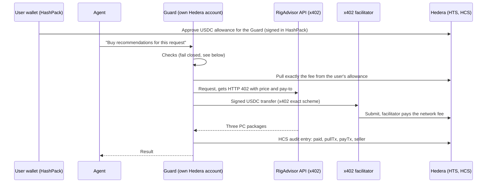

# EthPC: the PC agent that shops for you, and never oversteps

Tell EthPC what you play and what you can spend. An AI agent finds shops on **Arkiv**, pays for expert recommendation data with **x402 in USDC on Hedera**, compares three complete gaming PCs, and haggles with each shop's AI agent over **A2A**. It can only spend from an allowance you approve once in your **HashPack** wallet, and every move it makes is logged publicly on a **Hedera Consensus Service** topic. Reviews of shops need a **World ID** check, so they come from real people.

- **Demo video:** _add link_
- **Settled x402 payment (Hedera testnet):** [`0.0.9185802@1793920133.334517547`](https://hashscan.io/testnet/transaction/0.0.9185802-1793920133-334517547): 0.05 USDC from the Guard (`0.0.11289391`) to the recommendation service (`0.0.11286079`), network fee paid by the x402 facilitator (`0.0.9185802`).
- **The allowance pull that funded it:** [`0.0.11289391@1793920131.554598077`](https://hashscan.io/testnet/transaction/0.0.11289391-1793920131-554598077): 0.05 USDC from the user's wallet (`0.0.11289315`) to the Guard, as an approved-allowance transfer.
- **Public audit log (HCS topic):** [`0.0.11286082`](https://hashscan.io/testnet/topic/0.0.11286082): every `paid` entry names its pull and payment transactions.

## What the user sees

1. **Describe the PC.** "Find me a gaming PC with a 4K monitor, within 4,000 USDC." Only the budget is required; everything else gets a stated default.
2. **Sign in with Google.** Your prompt is kept, and you continue where you left off.
3. **Connect HashPack and approve one allowance**, for example 0.20 USDC. That's all the agent may ever spend on data. Nothing leaves your wallet yet.
4. **The agent works on its own:** it finds the recommendation service on Arkiv, pays its 0.05 USDC fee with x402, reads shop listings and reviews from Arkiv for free, and shows three complete PCs with compatibility checks. It then **checks its own payment on Hedera with the Hedera Agent Kit**: the transfer, the allowance pull and the public audit entry.
5. **Pick one and let your agent negotiate.** You watch your agent and the shop's agent haggle live over A2A; a deal pops up with what you saved.
6. **Check out** with a mock card (the PC itself isn't paid in crypto), mark it delivered, and **write a review** after a World ID check.

The sidebar always shows the allowance left, and **Revoke** ends it in one transaction. **Activity** and **Audit** show every payment and Guard decision.

## How the money moves

The agent has **no wallet and no keys**. It can only ask the **Guard**, which has its own Hedera account.



1. **Allowance.** In HashPack the user approves a USDC allowance with the Guard's account as spender (`AccountAllowanceApproveTransaction`). Hedera enforces the cap, and revoking it is one transaction.
2. **Pull, then pay.** x402 on Hedera needs the paying account to sign, so it can't pay straight from an allowance. For each fee the Guard pulls exactly that amount from the user (an approved transfer; Hedera refuses it if the allowance is too low or revoked), waits until the Mirror Node shows the funds, then pays the seller through x402. If the payment fails, the Guard refunds the user.
3. **Audit.** Every decision (paid, blocked, refunded, allowance approved or revoked, order placed, review published) is a message on the HCS topic. `npm run verify` checks from public data alone that every USDC leaving the Guard has an audit entry.
4. **Step-ups.** A fee above the user's "ask me" amount becomes a **Scheduled Transaction** for the exact amount; nothing moves until the user signs it in HashPack, and it expires on its own.

### The Guard's checks, in order (fail closed)

Duplicate request → active allowance → listing found on Arkiv, published by an approved owner, not expired → category allowed → per-fee limit (never above 1 USDC, `MAX_FEE_UNITS`) and remaining allowance → seller account exists on the Mirror Node → the seller's 402 terms match the listing, checked **before** signing → AI intent check against the user's task → step-up if above the "ask me" amount → allowance pull → x402 payment → refund if it fails.

## Sponsor technology

### Hedera

| Feature | Where |
|---|---|
| **x402 on Hedera** (`@x402/express`, `@x402/hedera`, official `x402.org` facilitator) | The recommendation API is x402-protected and settles USDC on testnet (`src/sellers.mjs`); the Guard pays it (`src/guard.mjs`) |
| **HTS (USDC `0.0.429274`)** allowances and approved transfers | `src/user-wallet.mjs`, `src/ledger.mjs` |
| **HCS** tamper-evident audit log of agent spending | `src/ledger.mjs`, read back by `src/verify.mjs` |
| **Scheduled Transactions** for human approval above a set amount | `src/ledger.mjs` (`ScheduleCreateTransaction`), signed in HashPack |
| **Mirror Node REST API** to confirm allowances, balances and settlement | `src/ledger.mjs`, `src/verify.mjs` |
| **Hedera Agent Kit** (`@hashgraph/hedera-agent-kit`, read-only query tools, no key): after paying, the agent verifies its own payment on Hedera: the x402 transfer and the allowance pull (`get_transaction_record_query_tool`) and the Guard's HCS audit entry naming both (`get_topic_messages_query_tool`). The build page shows "Verified on Hedera by the agent" with HashScan links | `src/onchain-proof.mjs`, `GET /api/pc/proof/:id`; spending report in `src/spend-report.mjs` |
| **Hedera Network MCP** (hosted, `agentic-testnet-mcp.hedera.com`) alongside EthPC's own MCP server, so Claude can shop through the Guard and manage the wallet in one chat | see [Use it from Claude](#use-it-from-claude-mcp) |
| **Spending controls**: allowance budget, per-fee cap, approved-seller allowlist, approval above an amount | `src/guard.mjs` |
| **A2A negotiation** between the buyer agent and each shop's AI agent | `src/a2a.mjs`, `src/seller-brain.mjs`, `src/buyer-brain.mjs` |
| **No Solidity**: everything uses the JS SDK (`@hiero-ledger/sdk`) and native services | |

### Arkiv
Shops publish their parts and prices to Arkiv from their own wallets; the recommendation API publishes its listing there too, so the agent discovers it without a hard-coded URL. Shop reviews are stored on Arkiv with a 90-day expiry, so ratings reflect recent buyers. Only listings from approved owners are trusted (`src/directory.mjs`, `src/pc-directory.mjs`, `src/reviews.mjs`).

### World
**Write a review** starts a World ID check (OIDC device flow). The server only accepts a review with a fresh, verified check for that order, one review per order (`src/orders.mjs`, `src/world.mjs`). Without Google sign-in configured, approving the allowance also needs World ID.

## Architecture

| Service | Port | Role |
|---|---|---|
| `src/web.mjs` | 4000 | Web app, Google sign-in, API for the page. Holds no Hedera key in HashPack mode |
| `src/sellers.mjs` | 4100 | RigAdvisor x402 API and the shops' A2A sales agents |
| `src/guard.mjs` | 4200 | The only service with a spending key: checks, pulls, pays, refunds, audits; orders and reviews |
| `src/agent.mjs` | 4300 | The buyer agent: reads the request, asks the Guard to pay, negotiates over A2A. No keys |
| `src/fac-sim.mjs` | 4020 | Local x402 facilitator, simulated mode only |

`start.mjs` starts each service as its own process and gives each one only the key it needs. Without credentials, every external part (Hedera, Arkiv, World, Google, the AI model) falls back to a clearly separated simulated mode, so the app and the tests run offline.

## Run it

**Requirements:** Node.js 22, a Hedera testnet account ([portal.hedera.com](https://portal.hedera.com/dashboard)), HashPack.

```bash
npm install
cp .env.example .env      # fill in testnet values only
npm run setup:hedera      # creates the Guard, seller and user accounts and the HCS topic; prints IDs only
npm run setup:usdc        # associates testnet USDC; then get test USDC at https://faucet.circle.com
npm run seed:arkiv        # publishes the recommendation API's listing on Arkiv (expires after a day)
npm run shop -- publish all   # publishes the shops' stock on Arkiv
npm run seed:reviews      # optional: sample shop reviews
npm start                 # then open http://localhost:4000
```

**Settings (`.env.example` lists them all):**
- **Hedera:** `HEDERA_*`, `GUARD_*`, `USER_*`, `SELLER_*`, `HCS_TOPIC_ID`, `PAY_ASSET=usdc`, `X402_FACILITATOR_URL`
- **Wallet:** `WALLET=hashpack`, `WALLETCONNECT_PROJECT_ID`
- **Arkiv:** `ARKIV_PRIVATE_KEY`, `ARKIV_ACCESS_KEY`, `APPROVED_OWNERS`
- **World ID:** `WORLD_ISSUER`, `WORLD_CLIENT_ID`, `WORLD_CLIENT_SECRET`
- **Google sign-in:** `GOOGLE_CLIENT_ID`, `GOOGLE_CLIENT_SECRET`, `GOOGLE_REDIRECT_URI`, `SESSION_SECRET`. In Google Cloud, create a Web application OAuth client with the redirect URI `http://localhost:4000/auth/google/callback`.
- **AI model:** `LLM_BASE_URL`, `LLM_API_KEY`, `LLM_MODEL`, used for reading requests, the intent check and the negotiating agents.

```bash
npm test      # 121 tests, simulated mode; stop a running copy first (same ports)
npm run verify    # live: checks the Guard's payments against the HCS log from public data only
```

## Use it from Claude (MCP)

`src/mcp.mjs` is an MCP server that lets Claude act as the buyer agent through the same Guard. It holds no keys and never shows the agent token to the model. Add it together with **Hedera's hosted MCP server**, so one chat can shop through the Guard and manage the wallet:

```bash
npm start
claude mcp add ethpc -- node "<path-to-repo>/src/mcp.mjs"
claude mcp add --transport http hedera-testnet https://agentic-testnet-mcp.hedera.com/mcp   # then /mcp → Authenticate with HashPack
```

**EthPC tools (PC flow)**

| Tool | What it does |
|---|---|
| `pc_requirements` | Reads a request in plain words; shows what was understood and the stated defaults. Free |
| `pc_allowance_status` | The allowance left and the fee per recommendation |
| `pc_request_allowance` | Asks for an allowance; the user approves it in the app with HashPack (Claude can't) |
| `pc_find_builds` | Pays the fee with x402 from the allowance through the Guard and returns three PCs plus the payment's transaction IDs. The same request is never paid twice |
| `pc_negotiate` | Haggles with the chosen shop's AI agent over A2A; returns every message and the deal |
| `pc_verify_payment` | The Hedera Agent Kit check: transfer, allowance pull and HCS audit entry |

The earlier general tools (`request_intent`, `get_intent`, `find_sellers`, `buy`, `make_offer`, `negotiate_price`, `check_purchase`, `spending_report`) are still there.

**Example prompt:** "Find me a 1440p gaming PC for GTA 6 under 1,500 USDC. Use the ethpc tools: check my allowance, find builds, verify the payment on Hedera, and negotiate the cheapest option. Then use hedera-testnet to show my USDC balance."

## What's real and what isn't

| Part | Status |
|---|---|
| Recommendation fee, allowance, pulls, refunds, step-ups, HCS audit | **Real**, Hedera testnet, USDC |
| Shop listings and reviews | **Real** records on Arkiv; the shops and their stock are sample data, not real products |
| A2A negotiation | **Real** agents (`@a2a-js/sdk`) with AI personas; each shop's lowest price is enforced in code |
| PC checkout, order, delivery | **Mock**: no card details collected, nothing charged, no real order |
| Performance estimates | Labelled sample estimates, not benchmarks |

## Known limits
- One user per running copy; the Google account decides who can use it.
- If the Guard's key were stolen, at most the remaining allowance is at risk. The cap, revoke and the audit log are the protection.
- An agreed shop price is valid for 5 minutes.

## Project layout
`src/` services and logic · `public/index.html` the web app · `wallet/` HashPack connector bundle · `test/` 121 tests (`node --test`) · `scripts-*.mjs` setup · `experiments/` live checks.
