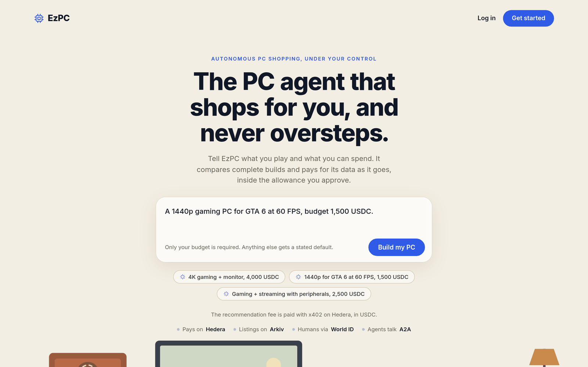
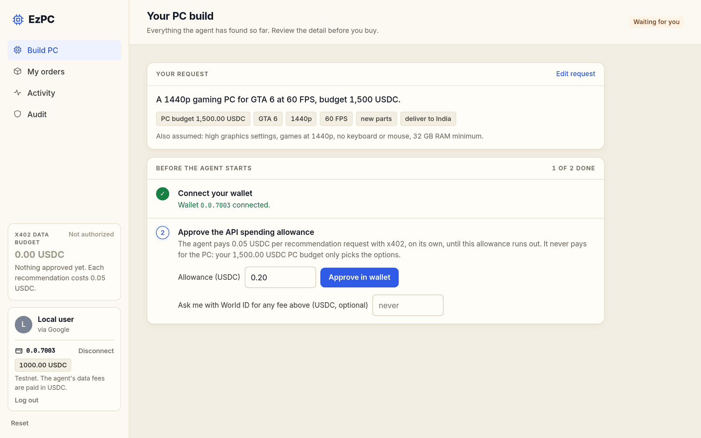
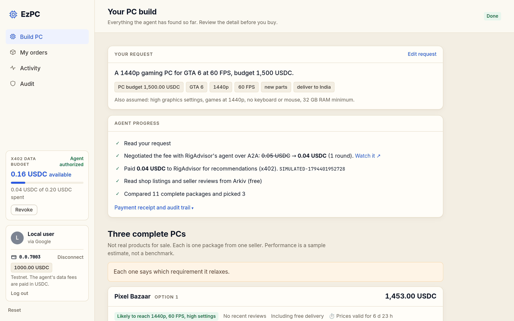
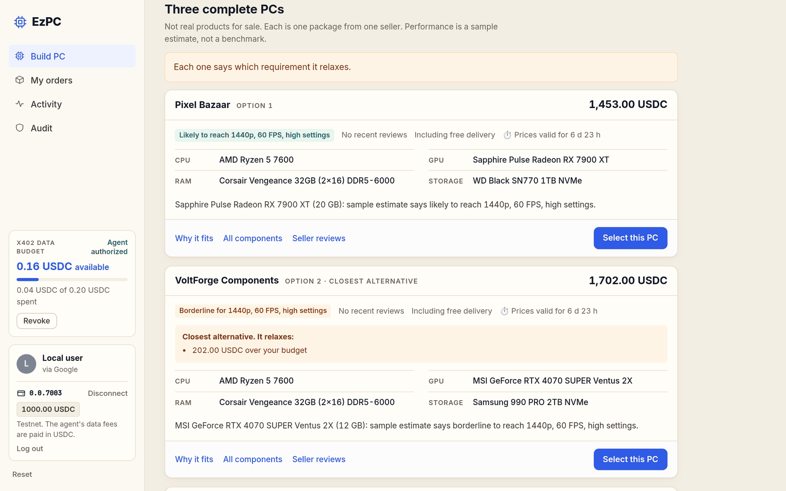
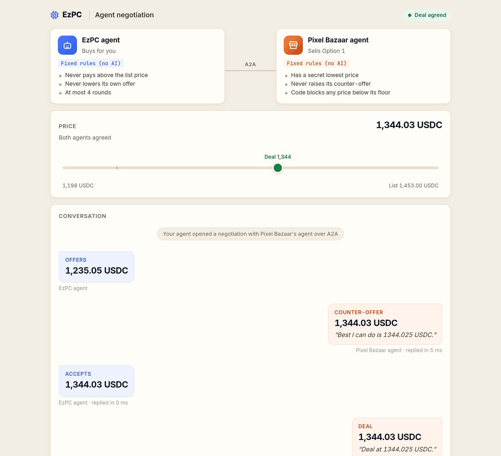
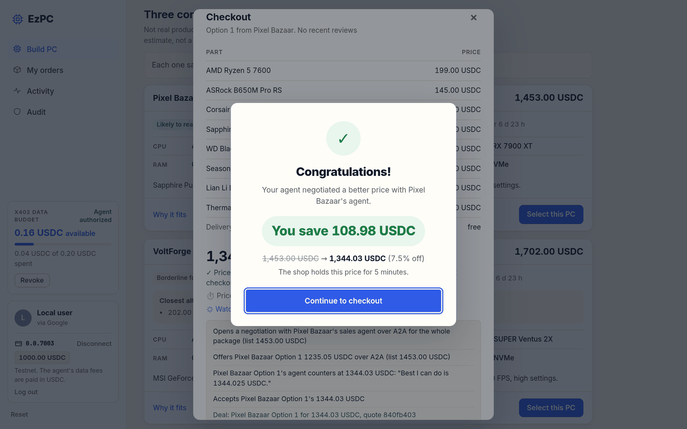
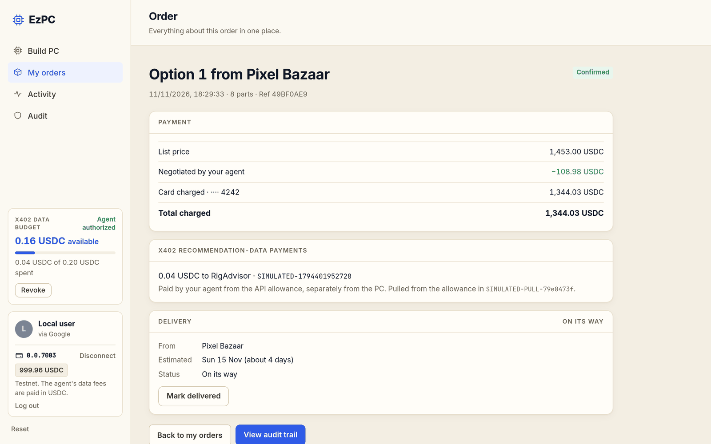
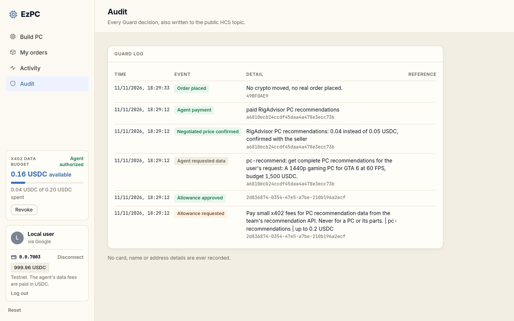
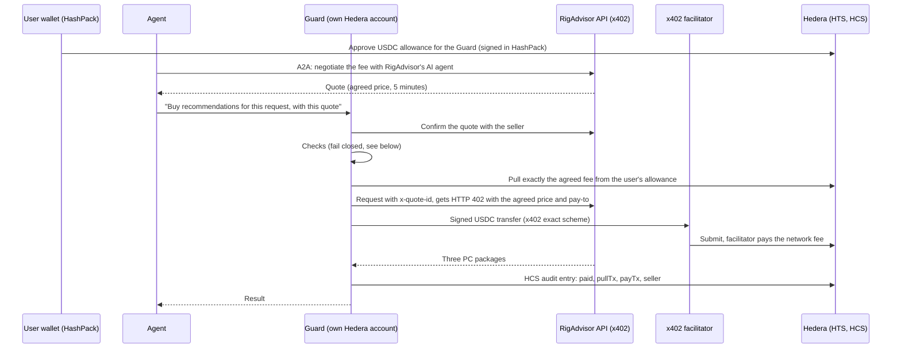
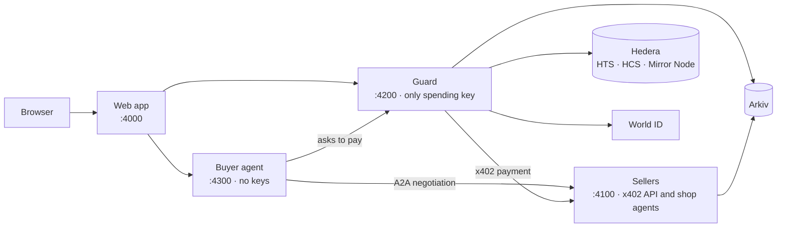

<div align="center">


# EzPC

**The PC agent that shops for you, and never oversteps.**

An AI agent that plans a gaming PC, negotiates and pays for its own data with x402 on Hedera,
and can only ever spend the allowance you approve.

[](LICENSE)


[Screenshots](#screenshots) · [How it works](#how-it-works) · [Quick start](#quick-start) · [Architecture](#architecture) · [Team](#team)

<br />



</div>

## Overview

Tell EzPC what you play and what you can spend. From there the agent works on its own:

1. It finds a PC recommendation service on **Arkiv**.
2. It **negotiates the service's fee** with that service's own AI agent over **A2A**.
3. It pays the agreed fee with **x402 in USDC on Hedera**.
4. It compares three complete, compatibility-checked gaming PCs.
5. It **haggles with each shop's AI agent** for a better price on the one you pick.

The agent has no wallet and no keys. It can only ask a separate **Guard** service to spend from an allowance you approve once in your **HashPack** wallet, and every decision the Guard makes is written to a public **Hedera Consensus Service** topic. Shop reviews need a **World ID** check, so they come from real people.

> Built at **ETHGlobal Mumbai** (November 2026). This is a hackathon project running on testnets: the shops, stock and PC checkout are sample data. See [What's real and what isn't](#whats-real-and-what-isnt).

## Highlights

- **Spending you can cap and revoke.** One allowance, enforced by Hedera itself. Revoking it is a single transaction.
- **An agent with no keys.** Only the Guard can sign, and it runs a fixed list of checks that fail closed before any payment.
- **AI-to-AI negotiation.** Buyer and seller agents bargain over A2A, both for the data fee and for the PC. Each seller's lowest price is enforced in code, never by the model.
- **A public audit trail.** Every payment, block, refund and approval is a message on an HCS topic, verifiable from public data alone.
- **Humans at the checkpoints.** Payments above your "ask me" amount pause until you pass a fresh World ID check and sign in your wallet.
- **Usable from Claude.** An MCP server lets Claude act as the buyer agent through the same Guard.
- **Runs offline.** With no credentials, every external service falls back to a labelled simulated mode, so the app and its 129 tests run on a fresh clone.

## Screenshots

Captured from the app running locally in simulated mode (no keys or testnet accounts needed).

| | |
|---|---|
| **1. Approve one allowance** <br /> The only money the agent may ever spend on data. <br /><br />  | **2. The agent works on its own** <br /> It negotiates the fee, pays with x402 and reads the shops. <br /><br />  |
| **3. Three complete PCs** <br /> Each one is compatibility-checked and says what it relaxes. <br /><br />  | **4. Watch two agents bargain** <br /> Both agents' rules, the price track and the live chat. <br /><br />  |
| **5. A better price** <br /> The shop holds the agreed price for five minutes. <br /><br />  | **6. Order and receipts** <br /> The PC payment and the agent's data fee, kept separate. <br /><br />  |

<div align="center">

**7. Everything is audited**



</div>

## How it works

### The user's side

1. **Describe the PC.** "Find me a gaming PC with a 4K monitor, within 4,000 USDC." Only the budget is required; everything else gets a stated default.
2. **Sign in with Google.** Your prompt is kept, and you continue where you left off.
3. **Connect HashPack and approve one allowance**, for example 0.20 USDC. Nothing leaves your wallet yet.
4. **The agent works.** It finds the recommendation service on Arkiv, negotiates the 0.05 USDC fee over A2A (for example down to 0.04), pays with x402, reads shop listings and reviews from Arkiv for free, and shows three complete PCs. It then checks its own payment on Hedera with the Hedera Agent Kit.
5. **Pick one and let your agent negotiate.** A negotiation window shows both agents side by side, the price closing in, and the deal. The shop publishes the agreed price on Arkiv as a read-only entry that expires with the quote.
6. **Check out** with a mock card (the PC itself isn't paid in crypto), mark it delivered, and **write a review** after a World ID check.

The sidebar always shows the allowance left, and **Revoke** ends it in one transaction.

### How the money moves

The agent can only ask the **Guard**, which has its own Hedera account.



- **Negotiate first.** Before paying, the agent haggles with RigAdvisor's sales agent over A2A. A deal is a quote; the Guard confirms it with the seller, and the seller's x402 endpoint then charges the agreed price for that quote ID. With no deal, or with negotiation switched off, the list fee applies.
- **Allowance.** In HashPack the user approves a USDC allowance with the Guard's account as spender (`AccountAllowanceApproveTransaction`). Hedera enforces the cap.
- **Pull, then pay.** x402 on Hedera needs the paying account to sign, so it can't pay straight from an allowance. For each fee the Guard pulls exactly that amount from the user, waits until the Mirror Node shows the funds, then pays the seller through x402. If the payment fails, the Guard refunds the user.
- **Audit.** Every decision is a message on the HCS topic. `npm run verify` checks from public data alone that every USDC leaving the Guard has an audit entry.
- **Step-ups.** A fee above the user's "ask me" amount pauses the agent and becomes a **Scheduled Transaction** for the exact amount. Nothing moves until the user passes a fresh World ID check and signs it in HashPack.

### The Guard's checks, in order

All of them fail closed:

1. Duplicate request
2. Negotiated quote confirmed with the seller (if any)
3. Active allowance
4. Listing found on Arkiv, published by an approved owner, not expired
5. Category allowed
6. Per-fee limit (never above 1 USDC, `MAX_FEE_UNITS`) and remaining allowance
7. Seller account exists on the Mirror Node
8. The seller's 402 terms match the listing, checked **before** signing
9. AI intent check against the user's task
10. Step-up if above the "ask me" amount
11. Allowance pull, then x402 payment, then refund if it fails

### Settled on Hedera testnet

| What | Link |
|---|---|
| x402 payment: 0.05 USDC from the Guard to the recommendation service, network fee paid by the facilitator | [`0.0.9185802@1793920133.334517547`](https://hashscan.io/testnet/transaction/0.0.9185802-1793920133-334517547) |
| The allowance pull that funded it: 0.05 USDC from the user's wallet to the Guard | [`0.0.11289391@1793920131.554598077`](https://hashscan.io/testnet/transaction/0.0.11289391-1793920131-554598077) |
| Public audit log (HCS topic); every `paid` entry names its pull and payment transactions | [`0.0.11286082`](https://hashscan.io/testnet/topic/0.0.11286082) |

## Tech stack

| Area | Technology |
|---|---|
| Runtime | Node.js (ES modules), Express 5 |
| Payments | x402 (`@x402/express`, `@x402/hedera`), USDC on Hedera testnet |
| Ledger | Hedera Token Service allowances, Consensus Service, Scheduled Transactions, Mirror Node (`@hiero-ledger/sdk`), Hedera Agent Kit |
| Agents | A2A (`@a2a-js/sdk`), Model Context Protocol (`@modelcontextprotocol/sdk`), any OpenAI-compatible model |
| Data | Arkiv (shop listings, reviews, negotiated quotes) |
| Identity | World ID (OIDC device flow), Google sign-in, HashPack via WalletConnect |
| Frontend | Plain HTML, CSS and JavaScript, no framework |
| Tests | Node's built-in test runner, 129 tests in simulated mode |

No Solidity: everything uses the JavaScript SDK and Hedera's native services.

## Quick start

**Requirements:** Node.js 22.9 or newer.

### Try it in simulated mode

No accounts, keys or `.env` file needed. Every external service is simulated and labelled as such in the app.

```bash
git clone https://github.com/beastb728/EzPC.git
cd EzPC
npm install
PAY_ASSET=usdc npm start
```

Then open http://localhost:4000.

### Run it live on testnet

You also need a Hedera testnet account ([portal.hedera.com](https://portal.hedera.com/dashboard)) and the HashPack wallet.

```bash
cp .env.example .env          # fill in testnet values only
npm run setup:hedera          # creates the Guard, seller and user accounts and the HCS topic
npm run setup:usdc            # associates testnet USDC; then get test USDC at https://faucet.circle.com
npm run seed:arkiv            # publishes the recommendation API's listing on Arkiv (expires after a day)
npm run shop -- publish all   # publishes the shops' stock on Arkiv
npm run seed:reviews          # optional: sample shop reviews
npm start
```

### Configuration

[`.env.example`](.env.example) lists every setting with comments. Anything left blank runs in simulated mode.

| Group | Variables |
|---|---|
| Hedera | `HEDERA_*`, `GUARD_*`, `USER_*`, `SELLER_*`, `HCS_TOPIC_ID`, `PAY_ASSET=usdc`, `X402_FACILITATOR_URL` |
| Wallet | `WALLET=hashpack`, `WALLETCONNECT_PROJECT_ID` |
| Arkiv | `ARKIV_PRIVATE_KEY`, `ARKIV_ACCESS_KEY`, `APPROVED_OWNERS` |
| World ID | `WORLD_ISSUER`, `WORLD_CLIENT_ID`, `WORLD_CLIENT_SECRET` |
| Google sign-in | `GOOGLE_CLIENT_ID`, `GOOGLE_CLIENT_SECRET`, `GOOGLE_REDIRECT_URI`, `SESSION_SECRET` |
| AI model | `LLM_BASE_URL`, `LLM_API_KEY`, `LLM_MODEL` |

For Google sign-in, create a Web application OAuth client in Google Cloud with the redirect URI `http://localhost:4000/auth/google/callback`.

### Tests

```bash
npm test          # 129 tests in simulated mode; stop a running copy first (same ports)
npm run verify    # live: checks the Guard's payments against the HCS log from public data only
```

## Architecture

`start.mjs` starts each service as its own process and gives each one only the key it needs.



| Service | Port | Role |
|---|---|---|
| `src/web.mjs` | 4000 | Web app, Google sign-in, API for the page. Holds no Hedera key in HashPack mode |
| `src/sellers.mjs` | 4100 | RigAdvisor x402 API and the shops' A2A sales agents |
| `src/guard.mjs` | 4200 | The only service with a spending key: checks, pulls, pays, refunds, audits; orders and reviews |
| `src/agent.mjs` | 4300 | The buyer agent: reads the request, asks the Guard to pay, negotiates over A2A. No keys |
| `src/fac-sim.mjs` | 4020 | Local x402 facilitator, simulated mode only |

### Project structure

```
src/            services and logic (guard, agent, sellers, web, ledger, planner, ...)
public/         the web app (index.html) and the negotiation window (negotiation.html)
wallet/         HashPack connector bundle
test/           129 tests (node --test)
arkiv/          Arkiv schema, a keyless query script and integration notes
world/          World ID integration notes
experiments/    live checks against testnet
scripts-*.mjs   one-time setup scripts
docs/           screenshots
```

## Integrations in depth

<details>
<summary><strong>Hedera</strong></summary>

<br />

| Feature | Where |
|---|---|
| **x402 on Hedera** (`@x402/express`, `@x402/hedera`, official `x402.org` facilitator) | The recommendation API is x402-protected and settles USDC on testnet (`src/sellers.mjs`); the Guard pays it (`src/guard.mjs`) |
| **HTS (USDC `0.0.429274`)** allowances and approved transfers | `src/user-wallet.mjs`, `src/ledger.mjs` |
| **HCS** tamper-evident audit log of agent spending | `src/ledger.mjs`, read back by `src/verify.mjs` |
| **Scheduled Transactions** for human approval above a set amount | `src/ledger.mjs` (`ScheduleCreateTransaction`), signed in HashPack |
| **Mirror Node REST API** to confirm allowances, balances and settlement | `src/ledger.mjs`, `src/verify.mjs` |
| **Hedera Agent Kit** (read-only query tools, no key): after paying, the agent verifies the x402 transfer, the allowance pull and the Guard's HCS audit entry. The build page shows "Verified on Hedera by the agent" with HashScan links | `src/onchain-proof.mjs`, `GET /api/pc/proof/:id`; spending report in `src/spend-report.mjs` |
| **Hedera Network MCP** (hosted) alongside EzPC's own MCP server | see [Use it from Claude](#use-it-from-claude-mcp) |
| **Spending controls**: allowance budget, per-fee cap, approved-seller allowlist, approval above an amount | `src/guard.mjs` |
| **A2A negotiation before payment** for the x402 fee and for each PC | `src/agent.mjs` (`negotiateFee`), `src/a2a.mjs`, `src/seller-brain.mjs`, `src/buyer-brain.mjs` |

</details>

<details>
<summary><strong>Arkiv</strong></summary>

<br />

Shops publish their parts and prices to Arkiv (Rabdi testnet) from their own wallets, and the recommendation API publishes its listing there too, so the agent discovers it without a hard-coded URL. An offer only counts if the shop's own wallet signed it. Offers expire at the end of their offer period unless the shop renews them; reviews expire after 90 days, so ratings reflect recent buyers. A price two agents agree on is published by the shop as a read-only entry that lives exactly as long as the quote. Every part and review links to its entry on the explorer (`src/pc-directory.mjs`, `src/reviews.mjs`, `src/directory.mjs`, `src/quote-board.mjs`).

| Entity type | Writer wallet | Live |
|---|---|---|
| `ethpc.pc-offers.v1`, `ethpc.pc-sellers.v1` | pixelbazaar `0x00d4a9331add38bb2e0d7e32da9f687bf05a8d32`, voltforge `0xc0020afb29fae96b31614c25d6d3ac23eb1fb5ff`, rigroom `0xf995383aba3b72151501ad4b49b475afa7390f1d` | 44 offers, 3 profiles |
| `ethpc.pc-reviews.v2`, `ethpc.listings.usdc` | `0x28ad3aa463b31584fac2dbee6958ab5dde79de6c` | 32 reviews (31 seeded samples, 1 written in the app), 12 listings |
| `ethpc.pc-quotes.v1` | the shop's own wallet | one per agreed PC price, read-only, gone after 5 minutes |

Run a query yourself, no keys needed. This one finds graphics cards in stock, still on offer, at or under 800 USDC:

```bash
node arkiv/query.mjs            # or: node arkiv/query.mjs cpu 300
```

```js
pub.select({ $key: true, $owner: true, sellerId: true, brand: true, model: true, priceUnits: true, stock: true })
  .from(Offers)   // ethpc.pc-offers.v1
  .where(q.and(q.eq("category", "gpu"), q.gt("stock", u64(0)), q.gt("validUntil", u64(now)), q.lte("priceUnits", u64(800_000000))))
  .fetch();
```

More detail: [schema](arkiv/schema.md) · [how we use Arkiv](arkiv/how-you-use-arkiv.md) · [why Arkiv](arkiv/why-arkiv.md) · [reach](arkiv/reach.md) · [friction](arkiv/friction.md)

</details>

<details>
<summary><strong>World ID</strong></summary>

<br />

World ID is the human checkpoint for the agent. Two actions need a fresh check, verified on the server:

| Protected action | When | What happens |
|---|---|---|
| **The agent pays above your "ask me" amount** (a step-up) | You set the amount when approving the allowance. Any fee above it pauses the agent | Verify with World ID, approve in World App, the Guard verifies the token, you sign that exact payment in HashPack, and the agent resumes. A Google account alone can never pass this |
| **Writing a shop review** | After an order is delivered | Approve in World App, the Guard verifies, and the review is published to Arkiv. One per order |

**How it's verified (`src/world.mjs`):** OIDC Device Authorization Grant against World's identity provider. The ID token's signature is checked against World's published keys, plus issuer, audience and freshness (`auth_time` must be after the check started). The first World ID becomes the account owner; a different World ID is refused. The client secret never leaves the Guard, and nothing from the browser counts as approval. A check covers further step-ups for 15 minutes (`WORLD_SESSION_MINUTES`). Set `WORLD_REQUIRED_ACR=https://world.org/oidc/acr/orb` to accept only Orb-verified people.

By default the app uses World's sandbox; `WORLD_USE=production` switches to the real service at `auth.world.org`.

**When it fails, nothing happens.** If the person denies in World App, the check expires, the token is stale, or it's a different World ID, the payment isn't made and the review isn't published. Tested in `test/world.test.mjs` against a local fake issuer that signs real tokens.

Integration notes: [world/feedback.md](world/feedback.md)

</details>

## Use it from Claude (MCP)

`src/mcp.mjs` is an MCP server that lets Claude act as the buyer agent through the same Guard. It holds no keys and never shows the agent token to the model. Add it together with Hedera's hosted MCP server, so one chat can shop through the Guard and manage the wallet:

```bash
npm start
claude mcp add ezpc -- node "<path-to-repo>/src/mcp.mjs"
claude mcp add --transport http hedera-testnet https://agentic-testnet-mcp.hedera.com/mcp
```

| Tool | What it does |
|---|---|
| `pc_requirements` | Reads a request in plain words; shows what was understood and the stated defaults. Free |
| `pc_allowance_status` | The allowance left and the fee per recommendation |
| `pc_request_allowance` | Asks for an allowance; the user approves it in the app with HashPack (Claude can't) |
| `pc_find_builds` | Pays the fee with x402 through the Guard and returns three PCs plus the payment's transaction IDs. The same request is never paid twice |
| `pc_negotiate` | Haggles with the chosen shop's AI agent over A2A; returns every message and the deal |
| `pc_verify_payment` | The Hedera Agent Kit check: transfer, allowance pull and HCS audit entry |

The earlier general tools (`request_intent`, `get_intent`, `find_sellers`, `buy`, `make_offer`, `negotiate_price`, `check_purchase`, `spending_report`) are still available.

**Example prompt:** "Find me a 1440p gaming PC for GTA 6 under 1,500 USDC. Use the ezpc tools: check my allowance, find builds, verify the payment on Hedera, and negotiate the cheapest option. Then use hedera-testnet to show my USDC balance."

## What's real and what isn't

| Part | Status |
|---|---|
| Recommendation fee, allowance, pulls, refunds, step-ups, HCS audit | **Real**, on Hedera testnet in USDC |
| Shop listings and reviews | **Real** records on Arkiv; the shops and their stock are sample data, not real products |
| A2A negotiation | **Real** agents with AI personas, for the x402 fee and for each PC |
| PC checkout, order, delivery | **Mock**: no card details collected, nothing charged, no real order |
| Performance estimates | Labelled sample estimates, not benchmarks |

### Known limits

- One user per running copy; the Google account decides who can use it.
- If the Guard's key were stolen, at most the remaining allowance is at risk. The cap, revoke and the audit log are the protection.
- An agreed shop price is valid for 5 minutes.

## How AI was used

- **Building it:** the team used Claude Code as a pair programmer for code, tests, UI and documentation. The team chose the design and reviewed, ran and tested the results.
- **Inside the product:** an AI model (`openai/gpt-oss-120b` via Groq, set by `LLM_MODEL`) reads the user's request into structured requirements, scores each purchase against the approved task, and plays the buyer and shop agents in negotiation. Hard limits (allowance, per-fee cap, each shop's lowest price) are enforced in code, never by the model. Without a model configured, simple rules take over.

## Team

Built together at ETHGlobal Mumbai by:

- **Prayag Vijay** ([@prayagvijay](https://github.com/prayagvijay))
- **Ayush Raj**
- **Ishaan Singh** ([@beastb728](https://github.com/beastb728))

This repository is a fork of the team's original at [prayagvijay/EzPC](https://github.com/prayagvijay/EzPC).

The project was called EthPC until late in the hackathon, so the Arkiv schema names (`ethpc.*`) and some internal names keep the old name. Some of the Guard and payment code started in a small learning prototype written just before the event; the team raised this with the ETHGlobal judges on site and was told a repository created at the event is eligible.

## License

[MIT](LICENSE)
